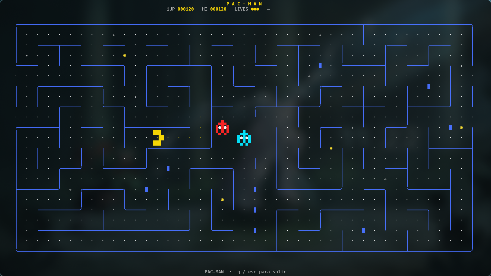

<div align="center">

# Pac-Man TUI

**Un laberinto arcade autónomo, directamente en tu terminal.**

[](https://go.dev/)
[](https://github.com/gdamore/tcell)
[](#características)

</div>

<p align="center">
  
</p>

<p align="center"><em>Una partida en vivo: el laberinto y la persecución avanzan solos.</em></p>

## Acerca del proyecto

Pac-Man TUI es una pequeña simulación arcade para terminal, escrita en Go. En
cada ronda genera un laberinto nuevo: Pac-Man busca puntos mientras tres
fantasmas lo persiguen, lo anticipan o recorren el mapa. Las píldoras de poder
invierten la persecución por unos instantes.

Está pensada para dejarse correr como animación de escritorio en una terminal.
Pac-Man juega de forma autónoma; no requiere controles de movimiento.

## Características

- Laberintos procedurales con túneles laterales.
- Tres comportamientos de fantasmas: persecución, emboscada y movimiento errático.
- Píldoras de poder, vidas, puntaje, récord y avance de nivel.
- Interfaz arcade con sprites animados y paredes azules.
- Adaptación al tamaño de la terminal, incluidos los cambios de ventana.
- Renderizado incremental para reducir el parpadeo y las escrituras.

## Requisitos

- Go 1.24 o superior.
- Una terminal compatible con UTF-8 y color.

## Ejecución

```bash
git clone https://github.com/EnzoPatino/pacman-tui.git
cd pacman-tui
go run ./cmd/glimmer
```

Para compilar un ejecutable local:

```bash
go build -o pacman-tui ./cmd/glimmer
./pacman-tui
```

## Controles

| Tecla | Acción |
|:--|:--|
| `q` | Salir |
| `Esc` | Salir |
| `Ctrl+C` | Salir |

## Estructura

| Directorio | Responsabilidad |
|:--|:--|
| `cmd/glimmer` | Inicio de la aplicación |
| `internal/game` | Reglas, personajes y decisiones autónomas |
| `internal/maze` | Generación y navegación del laberinto |
| `internal/ui` | Sprites, interfaz y renderizado de terminal |

## Tecnologías

[Go](https://go.dev/) y [tcell](https://github.com/gdamore/tcell). Las
dependencias se descargan automáticamente al ejecutar o compilar el proyecto.
